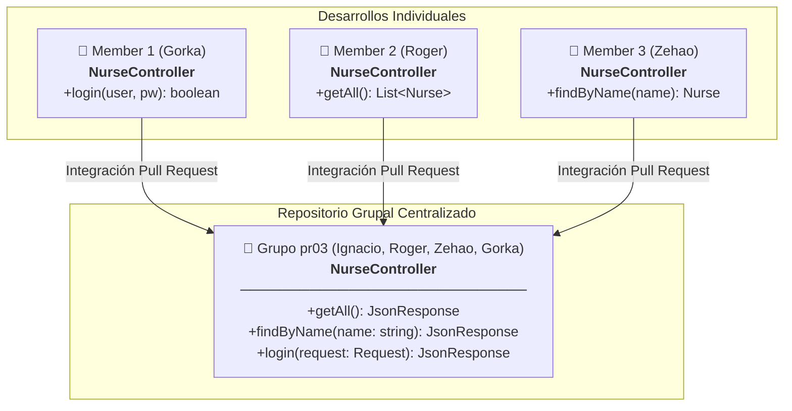
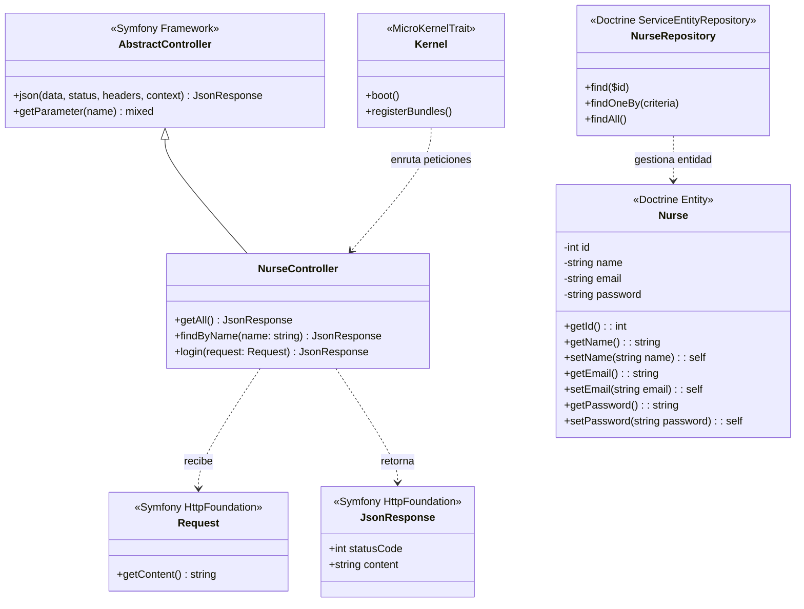
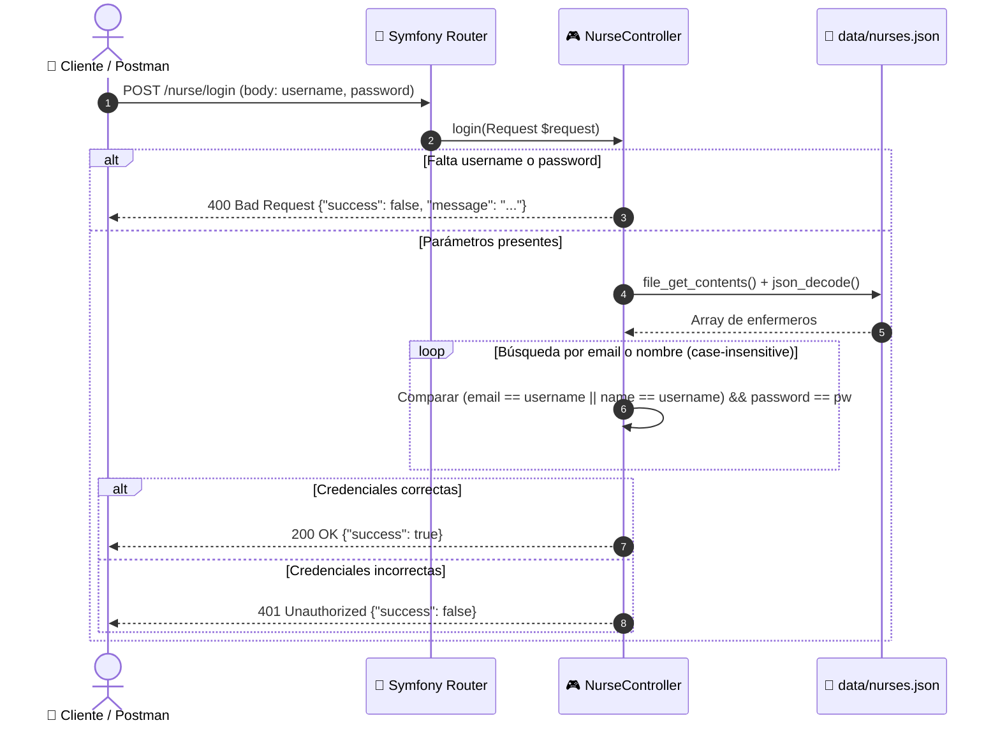
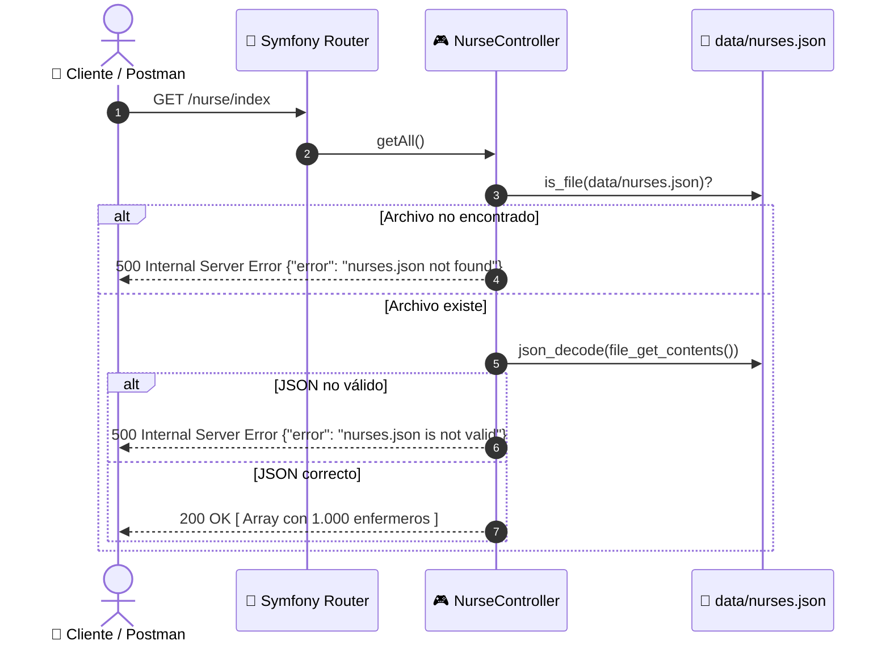
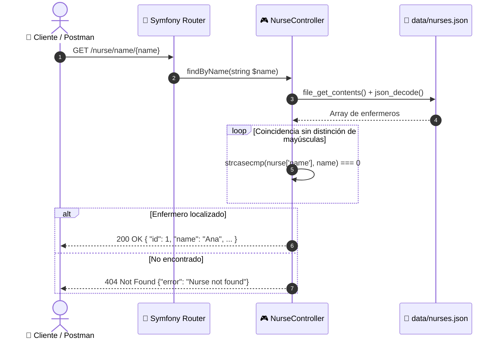

<div align="center">

# 🏥 Ignacio Nurse Simulator

[](https://symfony.com/)
[](https://www.php.net/)
[](https://www.doctrine-project.org/)
[](https://www.mysql.com/products/workbench/)
[-E2001A?style=for-the-badge)](https://www.stucom.com/)
[](LICENSE)

<p align="center">
  <strong>API REST de Simulación y Gestión Hospitalaria de Personal de Enfermería</strong><br>
  M0616 — Proyecto Intermodular | 2º Desarrollo de Aplicaciones Web (DAW)
</p>

[🔗 Repositorio Principal (Nurse-Simulator)](https://github.com/Ignaciobrenas/Nurse-Simulator) • [🇪🇸 Documentación Completa (ES)](docs/general/DOCUMENTACION_ES.md) • [🇬🇧 Full Documentation (EN)](docs/general/DOCUMENTATION_EN.md) • [Colección Postman](docs/postman/nurse-api.postman_collection.json)

---

</div>

> [!IMPORTANT]
> **Repositorio de demostración individual:** Este repositorio es una copia y extensión individual de mi repositorio principal grupal [**Nurse-Simulator**](https://github.com/Ignaciobrenas/Nurse-Simulator).  
> Su propósito es demostrar de forma práctica y técnica:
> 1. La gestión avanzada de paquetes con **Composer**.
> 2. La instalación, configuración e integración de **Doctrine ORM** y **Doctrine Migrations Bundle**.
> 3. La creación y modelado de **Entidades** y **Repositorios** (`App\Entity\Nurse`) mediante atributos modernos de PHP 8.
> 4. El uso, persistencia y control de esquema sobre una **base de datos relacional local en MySQL/MariaDB**, administrada visualmente con **MySQL Workbench**.

---

## 📖 1. Sobre el Proyecto

**Ignacio Nurse Simulator** es una API REST desarrollada con **Symfony 7.4** y **PHP 8.2+** orientada a simular la administración, consulta e identificación de los enfermeros de un complejo hospitalario.

Este proyecto tiene su base en la fase inicial (**pr03 — Introducción Backend**) del **Proyecto Intermodular (M0616)** cursado en **2º DAW** en el centro **STUCOM Pelai (Barcelona)** durante el curso académico **2026/2027**. 

A diferencia del repositorio base que trabajaba sobre almacenamiento desacoplado en archivos planos (`data/nurses.json`), en este repositorio se incorpora la capa completa de acceso a datos relacional mediante el ORM de **Doctrine**, permitiendo sincronizar la lógica de negocio con tablas reales de MySQL gestionadas en **MySQL Workbench**.

### 👥 Equipo de Desarrollo y Roles del Repositorio Principal (Grupo pr03)

| Miembro | Rol y Responsabilidades | GitHub |
|---|---|---|
| **Ignacio Breñas** | **Project Manager & Tech Lead**<br>• Dirección y organización integral del equipo de desarrollo.<br>• Creación y estructuración de las ramas de trabajo individuales de cada miembro.<br>• Definición, reparto y seguimiento de Issues en el tablero de GitHub Projects.<br>• Supervisión de calidad, revisión e integración de Pull Requests asegurando el correcto funcionamiento global.<br>• Inicialización del framework Symfony 7.4 y centralización de la suite de pruebas en Postman.<br>• Implementación de persistencia con Doctrine ORM, migraciones y conexión a MySQL Workbench. | [@Ignaciobrenas](https://github.com/Ignaciobrenas) |
| **Christopher Roger Tito** | **Desarrollador Backend**<br>• Implementación del endpoint de lectura general de enfermeros (`getAll`).<br>• Pruebas y evidencias en Postman para el listado global. | [@RogerTito455](https://github.com/RogerTito455) |
| **Zehao Yin** | **Desarrollador Backend**<br>• Implementación del endpoint de búsqueda por nombre (`findByName`).<br>• Ampliación del dataset de pruebas a 1.000 enfermeros en JSON. | [@zyin-08](https://github.com/zyin-08) |
| **Gorka Ramirez** | **Desarrollador Backend**<br>• Implementación del endpoint de validación y login de enfermeros (`login`).<br>• Pruebas unitarias de credenciales y evidencias en Postman. | [@gorkaramirez936](https://github.com/gorkaramirez936) |

---

## 🗄️ 2. Integración de Base de Datos Local (Doctrine & MySQL Workbench)

Para demostrar las capacidades de backend profesional, este repositorio implementa un flujo completo de base de datos relacional:

### 2.1. Gestión de Dependencias con Composer
Se instalaron y configuraron los paquetes oficiales del ecosistema Doctrine:
* `doctrine/doctrine-bundle` y `doctrine/orm`: Capa de abstracción y mapeo objeto-relacional.
* `doctrine/doctrine-migrations-bundle`: Control de versiones y evolución del esquema de la base de datos.
* `symfony/maker-bundle`: Generación asistida de código bajo estándares de Symfony.

### 2.2. Configuración del Entorno Local (`.env`)
En el archivo de entorno local se conecta Symfony con el servidor local MySQL / MariaDB:
```dotenv
###> doctrine/doctrine-bundle ###
DATABASE_URL="mysql://root:@127.0.0.1:3306/nurse_simulator?serverVersion=10.4.32-MariaDB&charset=utf8mb4"
###< doctrine/doctrine-bundle ###
```

### 2.3. Modelado de la Entidad `Nurse`
Se definió la entidad en [`src/Entity/Nurse.php`](src/Entity/Nurse.php) junto a su repositorio [`src/Repository/NurseRepository.php`](src/Repository/NurseRepository.php), empleando atributos nativos de PHP 8:
* `id` (`INT`, auto-incremental, clave primaria).
* `name` (`VARCHAR(100)`, obligatorio).
* `email` (`VARCHAR(180)`, índice único).
* `password` (`VARCHAR(255)`, obligatorio).

### 2.4. Migraciones y Control de Esquema
A través de la migración [`migrations/Version20261016160000.php`](migrations/Version20261016160000.php), el esquema se traslada de forma determinista y reproducible a la base de datos física:
```bash
# Ejecutar migraciones pendientes
php bin/console doctrine:migrations:migrate
```

### 2.5. Administración con MySQL Workbench
La base de datos `nurse_simulator` y la tabla `nurse` se inspeccionan y gestionan localmente desde **MySQL Workbench**, permitiendo verificar la correcta creación de índices únicos, tipos de columna y consistencia de datos frente a las operaciones del ORM.

---

## 🎯 3. Objetivos de la Práctica (STUCOM pr03)

Siguiendo las especificaciones del documento oficial docente (`pr03_Introduccio_back_end`):
1. **Aprendizaje y bases del trabajo grupal con Symfony:** Creación de proyecto modular e integración progresiva de ramas de trabajo en equipo.
2. **Desarrollo de API REST:** Exposición de endpoints HTTP que devuelven respuestas en formato JSON.
3. **Flujo de trabajo individual a grupal:**
   - Desarrollo individual de endpoints especializados por cada miembro.
   - Fusión e integración coordinada en un repositorio común ([`Nurse-Simulator`](https://github.com/Ignaciobrenas/Nurse-Simulator)).
4. **Verificación exhaustiva:** Chequeo funcional de cada endpoint mediante **Postman** y registro de evidencias.

---

## 🏗️ 4. Arquitectura y Esquemas UML

### 4.1. Esquema de Integración Modular (Trabajo Individual ➡️ Repositorio Común)



---

### 4.2. Diagrama de Clases UML



---

### 4.3. Diagramas de Secuencia

#### A. Inicio de Sesión (`POST /nurse/login`)


#### B. Consulta General (`GET /nurse/index`)


#### C. Búsqueda por Nombre (`GET /nurse/name/{name}`)


---

## ⚡ 5. Especificación de la API REST

### Endpoints Disponibles

| Método | Ruta | Parámetros | Códigos HTTP | Descripción |
|---|---|---|---|---|
| `GET` | `/nurse/index` | *Ninguno* | `200`, `500` | Devuelve el catálogo completo de 1.000 enfermeros. |
| `GET` | `/nurse/name/{name}` | Path: `{name}` | `200`, `404` | Localiza un enfermero por su nombre (*case-insensitive*). |
| `POST` | `/nurse/login` | Body JSON: `username`, `password` | `200`, `400`, `401` | Inicia sesión verificando credenciales contra email o nombre. |

### Colección de Pruebas Postman

El repositorio incluye la suite de pruebas lista para importar:
* 📄 [`docs/postman/nurse-api.postman_collection.json`](docs/postman/nurse-api.postman_collection.json)
* 📸 Evidencias de ejecución: [`docs/postman/login`](docs/postman/login), [`docs/postman/readAll`](docs/postman/readAll), [`docs/postman/readByName`](docs/postman/readByName).

---

## 🔄 6. Flujo de Trabajo en GitHub

El equipo siguió una metodología estricta basada en ramas, issues y pull requests:


* **Gestión y Liderazgo:** Ignacio Breñas ejerció el rol de **Project Manager**, planificando las entregas, estructurando las ramas de trabajo, asignando issues y supervisando la integración continua.
* **Convención de commits:** `usuario/Tipo: descripción #issue` (ej. `roger/Feat: implement read all nurses from file #2`).
* **Tablero Kanban:** Gestión mediante GitHub Projects (`Todo`, `In progress`, `Done`).
* **Integración controlada:** Ramas individuales de feature ➡️ `staging` mediante Pull Request con revisión de código ➡️ `main` para versiones estables.

---

## 🚀 7. Instalación y Ejecución Rápida

### Requisitos Previos
* **PHP >= 8.2** con extensiones comunes (`pdo_mysql`, `json`, `mbstring`, `ctype`).
* **Composer** (v2 o superior).
* **MySQL** o **MariaDB** (local o vía XAMPP/Docker) y **MySQL Workbench**.
* *(Opcional)* **Symfony CLI**.

### Puesta en Marcha

```bash
# 1. Clonar el repositorio
git clone https://github.com/Ignaciobrenas/Ignacio-Nurse-Simulator.git
cd Ignacio-Nurse-Simulator

# 2. Instalar dependencias de Symfony y Doctrine
composer install

# 3. Configurar entorno local (definir credenciales de base de datos)
cp .env.example .env

# 4. Crear la base de datos y ejecutar migraciones de Doctrine
php bin/console doctrine:database:create
php bin/console doctrine:migrations:migrate

# 5. Iniciar el servidor de desarrollo
symfony server:start
# O alternativamente con PHP CLI:
php -S localhost:8000 -t public
```

### Probar Endpoints con cURL

```bash
# Listado completo de enfermeros
curl -i http://localhost:8000/nurse/index

# Buscar enfermero por nombre
curl -i http://localhost:8000/nurse/name/Ana

# Iniciar sesión
curl -i -X POST http://localhost:8000/nurse/login \
  -H "Content-Type: application/json" \
  -d '{"username": "ana@hospital.com", "password": "ana123"}'
```

---

## 📂 8. Estructura del Proyecto

```
Ignacio-Nurse-Simulator/
├── bin/
│   └── console                            # CLI de Symfony
├── config/                                # Configuración de rutas, servicios y paquetes
│   ├── packages/
│   │   ├── doctrine.yaml                  # Configuración de conexión y ORM
│   │   └── doctrine_migrations.yaml       # Configuración de migraciones
│   ├── routes.yaml
│   └── services.yaml
├── data/
│   └── nurses.json                        # Dataset JSON de prueba (1.000 enfermeros)
├── docs/
│   ├── general/
│   │   ├── DOCUMENTACION_ES.md            # Memoria técnica completa en español
│   │   ├── DOCUMENTATION_EN.md            # Complete technical documentation in English
│   │   ├── Nurse-Simulator.docx           # Documento Word editable
│   │   └── Nurse-Simulator_...pdf         # Documento PDF oficial de entrega
│   └── postman/                           # Colección y capturas de prueba
│       ├── login/
│       ├── readAll/
│       ├── readByName/
│       └── nurse-api.postman_collection.json
├── migrations/
│   └── Version20261016160000.php          # Migración para la creación de la tabla nurse
├── public/
│   └── index.php                          # Front Controller
├── src/
│   ├── Controller/
│   │   └── NurseController.php            # Controlador con todos los endpoints
│   ├── Entity/
│   │   └── Nurse.php                      # Entidad ORM de Enfermero/a
│   ├── Repository/
│   │   └── NurseRepository.php            # Repositorio Doctrine para Nurse
│   └── Kernel.php                         # Kernel de la aplicación
├── .env.example                           # Plantilla de variables de entorno (con DATABASE_URL)
├── composer.json                          # Dependencias (Doctrine, Maker, Symfony)
├── composer.lock                          # Bloqueo de versiones exactas
├── symfony.lock                           # Recetas instaladas de Symfony Flex
├── LICENSE                                # Licencia MIT
└── README.md                              # Presentación visual del proyecto
```

---

<div align="center">
  <sub>Desarrollado por <strong>Ignacio Breñas</strong> • Proyecto Intermodular DAW 2 (2026/27) • STUCOM Pelai</sub><br>
  <sub>Basado en el repositorio principal grupal: <a href="https://github.com/Ignaciobrenas/Nurse-Simulator">Ignaciobrenas/Nurse-Simulator</a></sub>
</div>
